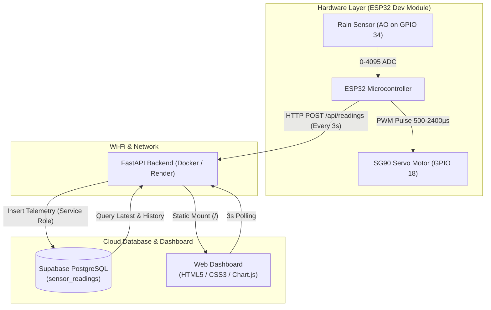

# Automatic Car Wiper 🚗🌧️
**IoT-Based Rain Detection and Automatic Wiper Control System**

An end-to-end IoT system powered by an **ESP32 microcontroller**, an **analog rain sensor**, and an **SG90 servo motor**, integrated with a containerized **Python FastAPI** backend, a **Supabase PostgreSQL** cloud database, and a real-time web-based monitoring dashboard using **Chart.js**.

---

## 📐 Architecture Overview



---

## ⚡ Hardware Wiring & Pin Mapping

| Component | Pin | ESP32 Pin | Voltage Level | Notes |
| :--- | :--- | :--- | :--- | :--- |
| **Rain Sensor Module** | **AO** (Analog Out) | **GPIO 34** | `3.3V` | ADC1 Channel 6 (Input Only) |
| **Rain Sensor Module** | **VCC** | **3.3V** | `3.3V` | Powered from ESP32 3V3 rail |
| **Rain Sensor Module** | **GND** | **GND** | `0V` | Common Ground |
| **SG90 Servo Motor** | **Signal** (Orange) | **GPIO 18** | `3.3V PWM` | Hardware LEDC PWM, 50 Hz |
| **SG90 Servo Motor** | **VCC** (Red) | **Regulated 5V** | `5V` | External 5V supply (prevents brownouts) |
| **SG90 Servo Motor** | **GND** (Brown) | **GND** | `0V` | Common Ground with ESP32 |

> [!IMPORTANT]
> The ESP32 and the external 5V servo power supply **must share a common ground (GND)** for PWM signal integrity.

---

## 🌧️ Sensor & Wiper Control Logic

- **Dry Condition (`rainValue > 3500`)**:
  - Wiper Status: `Off` (Parked at home position: `20°`).
  - Loop step delay: `300 ms`.
- **Rain Detected (`rainValue < 3000`)**:
  - Hysteresis band (`3000` to `3500`) prevents erratic on/off toggling.
  - Servo sweeps continuously between **`20°` and `120°`** in steps of **`±5°`**.
- **Light Rain (`1700 <= rainValue < 3000`)**:
  - Wiper Speed: **`Slow`** (`wipeDelay = 60 ms` per step).
- **Heavy Rain (`rainValue < 1700`)**:
  - Wiper Speed: **`Fast`** (`wipeDelay = 20 ms` per step).

---

## 🛠️ Project Structure

```
Automatic_Car_Wiper/
├── backend/
│   ├── config.py         # Safe environment variable configuration
│   ├── database.py       # Supabase client and query operations
│   ├── main.py           # FastAPI endpoints and static file serving
│   └── models.py         # Pydantic schemas and speed/status normalizers
├── frontend/
│   ├── app.js            # Chart.js graphing and live API polling (3s)
│   ├── index.html        # Modern responsive dark-navy dashboard
│   └── style.css         # Component styling and responsive layout
├── database/
│   └── schema.sql        # Supabase PostgreSQL schema with RLS protection
├── include/
│   ├── config.example.h  # Firmware credentials template
│   └── config.h          # Local firmware credentials (Git-ignored)
├── src/
│   └── main.cpp          # PlatformIO ESP32 C++ firmware
├── backup/               # Backups of initial Arduino .ino sketches
├── platformio.ini        # PlatformIO build & dependency configuration
├── Dockerfile            # Container configuration for Render deployment
├── .dockerignore         # Excludes secrets and embedded files from image
├── render.yaml           # Render Cloud Blueprint specification
├── requirements.txt      # Python backend dependencies
├── .env.example          # Environment variable template
└── README.md             # Project documentation
```

---

## 🚀 Quickstart: Running Locally

### 1. Python FastAPI Backend
```powershell
# Create and activate virtual environment
python -m venv venv
.\venv\Scripts\Activate.ps1

# Install dependencies
pip install -r requirements.txt

# Create .env from template
cp .env.example .env
# Fill in your SUPABASE_URL and SUPABASE_KEY in .env

# Run FastAPI backend with live reload
uvicorn backend.main:app --reload --port 8000
```
- Interactive API Docs: `http://127.0.0.1:8000/docs`
- Web Dashboard: `http://127.0.0.1:8000/`

### 2. PlatformIO ESP32 Firmware
```powershell
# 1. Copy credentials template
cp include/config.example.h include/config.h

# 2. Edit include/config.h with your Wi-Fi SSID, password, and backend IP

# 3. Build firmware with PlatformIO
pio run

# 4. Upload to ESP32 board (with ESP32 connected via USB)
pio run -t upload

# 5. Open Serial Monitor (115200 baud)
pio device monitor -b 115200
```

---

## 🐳 Docker Deployment

To build and run the backend and dashboard inside a container:

```bash
# Build the Docker image
docker build -t automatic-car-wiper .

# Run the container (binding to port 10000)
docker run -p 10000:10000 --env-file .env automatic-car-wiper
```
Access the dashboard at `http://localhost:10000`.

---

## ☁️ Cloud Deployment on Render

This project is pre-configured for automated deployment on [Render](https://render.com) using Docker.

1. **Push your code to GitHub** (ensure `.env` and `include/config.h` are git-ignored).
2. Log in to [Render Dashboard](https://dashboard.render.com).
3. Click **New +** → **Web Service**.
4. Connect your GitHub repository.
5. Select **Docker** as the runtime.
6. Under **Environment Variables**, add:
   - `SUPABASE_URL`: Your Supabase project URL (`https://your-id.supabase.co`)
   - `SUPABASE_KEY`: Your Supabase service role secret key
   - `PORT`: `10000`
7. Click **Create Web Service**.
8. Set the **Health Check Path** to `/api/health`.

Once deployed, update the `BACKEND_URL` in `include/config.h` on your ESP32 to point to your live Render domain:
```cpp
#define BACKEND_URL "https://automatic-car-wiper.onrender.com/api/readings"
```

---

## 🔒 Security Best Practices

- **Row Level Security (RLS)**: Public `anon` write access is disabled in `schema.sql`. Telemetry writes require the server-side secret key via FastAPI.
- **Zero Hardcoded Secrets**: Both Python and C++ source code use external Git-ignored configuration files (`.env` and `include/config.h`).
- **Resilient Wi-Fi**: The ESP32 wiper operates continuously even if Wi-Fi or backend services drop, retrying connections in the background without blocking the servo.

